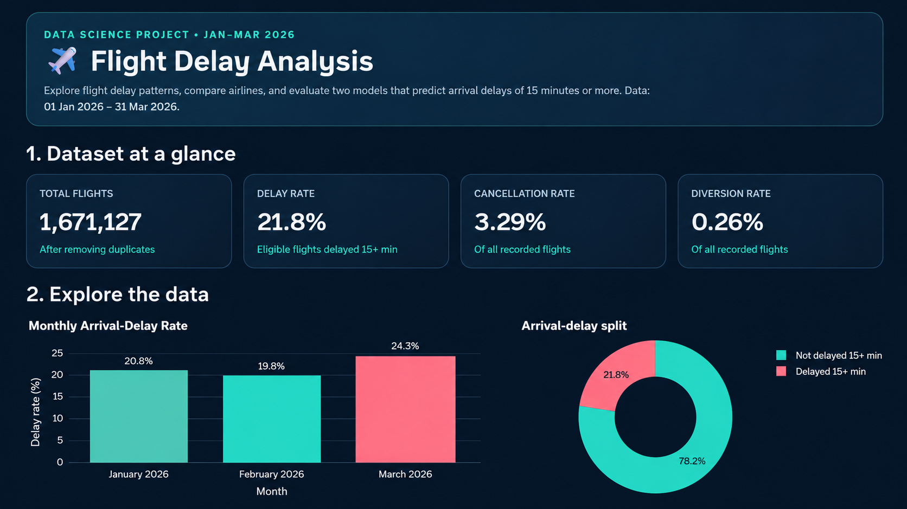

# ✈️ Flight Delay Analysis

A Data Science project that explores U.S. flight delays, identifies patterns across months and airlines, and compares machine-learning models for predicting whether a flight will arrive **15 minutes or more late**.

## Dashboard Preview



## Project Overview

This project uses U.S. Bureau of Transportation Statistics (BTS) / TranStats On-Time Reporting data for **January–March 2026**. It follows a typical Data Science workflow:

1. Load and combine monthly flight datasets.
2. Clean the data and remove duplicate records.
3. Explore delay, cancellation, and diversion patterns.
4. Visualize monthly delay rates and compare airlines.
5. Train and evaluate classification models.
6. Use the selected model to estimate the delay risk for a sample flight.

## Key Dataset Statistics

| Measure | Result |
|---|---:|
| Flight records after duplicate removal | 1,671,127 |
| Arrival-delay rate (eligible flights) | 21.8% |
| Cancellation rate | 3.29% |
| Diversion rate | 0.26% |
| Data period | January–March 2026 |

*These figures reflect the dataset processed for this project. The arrival-delay rate is calculated for eligible flights with an available arrival-delay outcome.*

## Dashboard Features

- **Dataset summary:** Total flights, arrival-delay rate, cancellation rate, and diversion rate.
- **Exploratory data analysis:** Monthly arrival-delay rate, delayed versus non-delayed flight split, and airline delay-rate comparison.
- **Model comparison:** Logistic Regression and Random Forest evaluated using accuracy, precision, recall, F1-score, and ROC-AUC.
- **Detailed evaluation:** Classification report and confusion matrix.
- **Sample prediction:** Estimate whether a flight is likely to arrive at least 15 minutes late based on scheduled flight details.

## Machine-Learning Approach

The target variable is `ARR_DEL15`:

- `0` — arrival delay of less than 15 minutes
- `1` — arrival delay of 15 minutes or more

The models compared are:

- **Logistic Regression** — a baseline classification model.
- **Random Forest** — an ensemble of decision trees.

The project uses an earlier period for training and a later period for testing, so the evaluation follows the time order of the data. A sample is used for model evaluation to keep the dashboard responsive.

In the current evaluation, **Random Forest has the higher F1-score and recall for delayed flights**, while Logistic Regression has higher overall accuracy. This illustrates why accuracy alone may not be sufficient when comparing models for an imbalanced target.

## Tech Stack

- Python
- Pandas and NumPy
- Scikit-learn
- Streamlit
- Plotly
- Joblib

## Project Structure

```text
flight-delay-analysis/
├── data/
│   ├── raw/
│   │   ├── janflights/
│   │   ├── febflights/
│   │   └── marchflights/
│   └── processed/
├── models/
├── reports/
│   └── figures/
├── src/
│   └── main.py
├── assets/
│   └── flight-delay-dashboard.png
├── requirements.txt
└── README.md
```

Your exact folders may differ slightly depending on which generated reports and model files are present in your local project.

## Run the Dashboard Locally

### 1. Clone the repository

```bash
git clone <YOUR-GITHUB-REPOSITORY-URL>
cd flight-delay-analysis
```

Replace `<YOUR-GITHUB-REPOSITORY-URL>` with your repository URL.

### 2. Create and activate a virtual environment

**Windows PowerShell:**

```powershell
python -m venv .venv
.\.venv\Scripts\Activate.ps1
```

### 3. Install dependencies

```powershell
python -m pip install -r requirements.txt
```

### 4. Start Streamlit

```powershell
python -m streamlit run src/main.py
```

Open the local URL printed in the terminal, usually `http://localhost:8501`.

## Data Source

U.S. Bureau of Transportation Statistics (BTS), TranStats — On-Time Reporting.

https://www.transtats.bts.gov/

The dashboard uses the monthly CSV files downloaded and supplied locally. The raw dataset is not included in this README package.

## Important Notes

- This is an educational Data Science project, not a live airline, airport, or weather forecasting service.
- Predictions are estimates based on historical patterns and the available scheduled-flight features.
- A high predicted delay risk does not guarantee that a specific flight will be delayed.
- Results depend on the selected date range, preprocessing choices, and sampled model-evaluation data.

## Project Developer

J.Mohana  
B.Tech — Computer Science Engineering (AI & Machine Learning)

---

